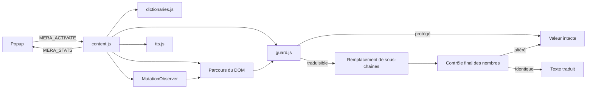

# MERA — Traduction financière camerounaise

> Extension Chrome (Manifest V3) qui traduit l'environnement de test **SAFINUM**
> en **ewondo, fulfulde, basaa et duala** — sans jamais modifier un montant,
> un numéro, une date ou une référence.

**Hackathon SAFINUM Innovate 2026** · Accessibilité linguistique · Prototype vérifié par 327 tests automatiques

[](#tests)
[](manifest.json)
[](LICENSE)

---

## Le problème

Au Cameroun, les interfaces de mobile money sont écrites en français ou en
anglais. Des millions de locuteurs parlent ewondo, fulfulde, basaa ou duala au
quotidien sans lire couramment ces langues.

Le risque n'est pas seulement de ne pas comprendre : c'est de **confirmer un
transfert sans saisir le montant débité, les frais appliqués ou l'identité du
bénéficiaire**. Une erreur de compréhension sur un écran financier se paie
immédiatement.

MERA répond à ce problème avec une contrainte non négociable : **la traduction
ne touche jamais aux valeurs**. Les chiffres, devises, dates, numéros de
téléphone et références de transaction restent strictement identiques.

---

## Ce que fait l'extension

| Fonction | Détail |
|---|---|
| **Traduit la page** | Détecte les 59 libellés réels du site et les remplace par la langue choisie |
| **Protège les valeurs** | Un garde-fou refuse toute modification d'un texte contenant un chiffre, une devise, une date, une référence, un email ou une URL |
| **Changement à chaud** | On change de langue depuis le popup **sans recharger la page** |
| **Gère le contenu dynamique** | `MutationObserver` + passes différées : le contenu React est traduit à mesure qu'il apparaît |
| **Préserve les saisies** | Ne touche jamais aux `input`, `textarea`, `select`, `contenteditable` |
| **Restaure** | Un clic remet la page en français |
| **Lecture vocale** | Optionnelle, via `speechSynthesis`, avec les mêmes protections financières |
| **Auto-réparation** | Détecte une version obsolète du script dans la page et recharge l'onglet une fois |

### Aperçu

| Avant (français) | Après (ewondo) |
|---|---|
| Banque en ligne | Bãg ya ńyī ɓe bɛ |
| Bonjour, Amina | Masug, Amina |
| Solde disponible | Mòni ma wom |
| Numéro de compte : | Nombro ya konte : |
| **SNF-2026-0001** | **SNF-2026-0001** 🔒 |
| **25 000 FCFA** | **25 000 FCFA** 🔒 |

---

## Installation rapide

### Depuis le dépôt

```bash
git clone https://github.com/darelle-kameni/mera-extension-safinum.git
cd mera-extension-safinum
npm install      # uniquement pour les tests (jsdom)
```

1. Ouvrir Chrome → `chrome://extensions/`
2. Activer le **Mode développeur** (en haut à droite)
3. Cliquer sur **Charger l'extension non empaquetée**
4. Sélectionner le dossier cloné
5. Ouvrir <https://safinum.cm/hackathon-test>
6. Cliquer sur l'icône **MERA** → choisir une langue → **Traduire la page**

> `npm install` n'est pas nécessaire pour utiliser l'extension : seuls les tests
> en ont besoin. Le dossier `src/` est autonome.

Guide détaillé, mise à jour et désinstallation : [`docs/INSTALLATION.md`](docs/INSTALLATION.md).

---

## Utilisation

1. **Traduire** — choisir une langue dans le menu. La traduction s'applique
   immédiatement.
2. **Changer de langue** — sélectionner une autre langue : la page est
   retraduite sans rechargement.
3. **Restaurer** — revenir au français d'origine.
4. **Écouter** — lire la page à voix haute (voix du navigateur).
5. **Diagnostic** — vérifier l'URL, la présence du content script et sa version
   en cas de problème.

Le popup affiche aussi un bilan : **traduits / protégés / ignorés**.

---

## Langues couvertes

| Langue | Code | Libellés | Source principale |
|---|---|---:|---|
| Français | `fr` | 59 | Langue d'origine de la page |
| English | `en` | 59 | Paires fr/en officielles du site |
| Ewondo | `ewo` | 59 | Corpus biblique `cameroon_bibles` (CC-BY-4.0) |
| Fulfulde (Adamawa) | `ful` | 59 | Corpus biblique `cameroon_bibles` (CC-BY-4.0) |
| Basaa | `bas` | 59 | Dictionnaire Njock 2019, SIL / Webonary |
| Duala | `dua` | 62 | Wiktionnaire, vocabulaire biblique, ressources d'apprentissage |

La provenance terme par terme — verset ou entrée de dictionnaire — est
documentée dans [`docs/SOURCES.md`](docs/SOURCES.md).

### Salutations

| Langue | « Bonjour » | Remarque |
|---|---|---|
| Ewondo | **Masug** | Variante citée : `Mbolo` |
| Fulfulde | **Jam waali** | Réponse : `Jam tan` |
| Basaa | **Mɛ̀ ǹyega** | Polyvalent (bonjour / merci / respect) |
| Duala | **Idiba bwam** | Littéralement « bon matin » |
| English | Hello | — |

---

## Comment ça marche



Le moteur ne « comprend » pas le texte : il remplace des **segments connus**,
du plus long au plus court, puis vérifie que la liste des nombres avant/après
est identique. Si un chiffre a bougé, la modification est annulée.

### Le garde-fou financier

`src/guard.js` bloque la traduction dès qu'un texte contient :

| Signal | Exemple bloqué | Résultat |
|---|---|---|
| Chiffre | `10 000`, `25000` | 🔒 intact |
| Devise | `FCFA`, `XAF`, `EUR`, `USD` | 🔒 intact |
| Téléphone / compte | `+237 6 57 41 67 60` | 🔒 intact |
| Référence | `SNF-2026-0001`, `TRX-ABC-12` | 🔒 intact |
| Date | `12/11/2026` | 🔒 intact |
| Pourcentage | `+2,4 %`, `50 %` | 🔒 intact |
| Email / URL | `contact@safinum.cm` | 🔒 intact |
| Libellé seul | `Solde` | ✅ traduit |
| Libellé + valeur | `Numéro de compte : SNF-…` | ✅ libellé traduit, valeur intacte |

Le second filet de sécurité est dans `content.js` : après remplacement, les
nombres extraits sont comparés un à un. Toute divergence annule l'opération.

---

## Tests

```bash
npm install
npm test
```

```
core 61 · engine 120 · page 46 · real-dom 49/65 textes
counter 19 · cycle 6 · reload 9 · multilang 8/8
switch 21 · TTS 19 · voix 9 · popup 9
```

**327 vérifications, 0 échec.** Elles couvrent notamment :

- les 17 formats de valeurs financières protégés ;
- les 59 libellés du site dans les 6 langues ;
- les textes composés (`Bonjour, Amina` → `Masug, Amina`) ;
- le changement de langue successif sur les 6 langues ;
- la double injection du content script ;
- une page déjà traduite par une version précédente (alias `Mbolo`) ;
- le compteur du popup et le cycle activer → restaurer → réactiver ;
- la détection de version obsolète et le rechargement automatique.

Détail des suites et protocole manuel : [`docs/TESTS.md`](docs/TESTS.md).

---

## Structure du projet

```
.
├── manifest.json              # Manifest V3 — permissions actives
├── src/
│   ├── guard.js               # Garde-fou financier (17 formats)
│   ├── dictionaries.js        # 6 dictionnaires, 59 clés françaises
│   ├── content.js             # Moteur : DOM, inverse, observer, messages
│   ├── tts.js                 # Lecture vocale indépendante
│   ├── popup.html             # Interface de contrôle
│   ├── popup.js               # Logique du popup + diagnostic
│   └── icon16/32/48/128.png   # Logo MERA
├── tests/                     # 12 suites, 327 vérifications
├── docs/
│   ├── DOCUMENTATION.md       # Dossier de présentation (jury)
│   ├── ARCHITECTURE.md        # Modules, flux, protocoles
│   ├── INSTALLATION.md        # Installation et mise à jour
│   ├── TESTS.md               # Suites et protocole de vérification
│   ├── CHANGELOG.md           # Historique des versions
│   ├── FAQ.md                 # Questions fréquentes
│   └── SOURCES.md             # Provenance des traductions
├── demo.html                  # Démo autonome (hors extension)
├── package.json
└── LICENSE
```

---

## Confidentialité et permissions

| Point | Réalité |
|---|---|
| Données collectées | **Aucune** |
| Stockage | **Aucun** (`storage` n'est pas demandé) |
| Appels réseau | **Aucun** |
| Traitement | Entièrement local, dans la page |
| Permissions | `activeTab`, `scripting`, `tabs` — nécessaires pour agir sur l'onglet actif et injecter le moteur |
| Hôtes autorisés | `https://safinum.cm/*` et `https://www.safinum.cm/*` uniquement |

Le choix de langue n'est volontairement pas persisté : à chaque ouverture, c'est
l'utilisateur qui décide. Cela évite qu'une langue mémorisée modifie la page au
rechargement.

---

## Limites assumées

1. **Terminologie mobile money.** « Solde », « frais de service » ou
   « transaction » sont absents des corpus sources (Bible, dictionnaire de 2019).
   Les termes retenus sont des **propositions documentées**, marquées
   `// à valider` dans le code. Le duala a été partiellement relu par un
   locuteur natif (14 novembre 2026) : 12 valeurs adoptées. L'ewondo, le
   fulfulde et le basaa restent à valider. Voir
   [`docs/VALIDATION.md`](docs/VALIDATION.md).

2. **Traduction par correspondance.** L'extension traduit des segments connus,
   pas par compréhension. Un libellé absent du dictionnaire reste en français.

3. **Lecture vocale indicative.** Aucun navigateur ne fournit de voix ewondo,
   fulfulde, basaa ou duala. La synthèse utilise une voix française : la
   prononciation n'est pas authentique.

4. **Périmètre.** L'extension est limitée à `safinum.cm`, conformément au
   périmètre du hackathon.

5. **Chargement à chaud.** Chrome ne remplace pas un content script déjà chargé.
   Le popup détecte la version obsolète et recharge la page — une fois.

---

## Feuille de route

- Validation des propositions lexicales avec des locuteurs natifs (ewondo,
  fulfulde, basaa, duala).
- Intégration d'un moteur TTS spécialisé (ex. Vambo AI pour le duala).
- Variantes de salutation selon le moment de la journée (matin / après-midi /
  soir), déjà documentées dans `docs/SOURCES.md`.
- Extension du dictionnaire à partir des retours d'usage.
- Réutilisation du moteur pour d'autres interfaces financières camerounaises.

---

## Documentation

| Document | Contenu |
|---|---|
| [`docs/DOCUMENTATION.md`](docs/DOCUMENTATION.md) | Dossier de présentation pour le jury |
| [`docs/ARCHITECTURE.md`](docs/ARCHITECTURE.md) | Architecture, flux de données, protocoles de messages |
| [`docs/INSTALLATION.md`](docs/INSTALLATION.md) | Installation, mise à jour, désinstallation |
| [`docs/TESTS.md`](docs/TESTS.md) | Suites de tests et vérification manuelle |
| [`docs/SOURCES.md`](docs/SOURCES.md) | Provenance de chaque terme, sources écartées |
| [`docs/VALIDATION.md`](docs/VALIDATION.md) | Validation par langue, source duala et points en attente |
| [`docs/CHANGELOG.md`](docs/CHANGELOG.md) | Historique des versions |
| [`docs/FAQ.md`](docs/FAQ.md) | Dépannage et questions fréquentes |

---

## Démo autonome

`demo.html` reproduit le parcours Safinum et embarque les mêmes modules
(garde-fou, dictionnaires, moteur, TTS). Ouvrir le fichier dans Chrome permet de
tester la traduction et la lecture vocale **sans installer l'extension**.

---

## Licence et attributions

- Code : **MIT** — voir [`LICENSE`](LICENSE).
- Corpus biblique : `flagship-ai/cameroon_bibles` (Hugging Face), **CC-BY-4.0**.
- Dictionnaire basaa : © 2019 Dr Pierre Emmanuel Njock, SIL — <https://www.webonary.org/basaa/>.
- Dictionnaire Duala : ressources d'apprentissage et vocabulaire biblique ;
  voir les réserves dans [`docs/SOURCES.md`](docs/SOURCES.md).
- Tableau trilingue duala : locuteur natif, 14 novembre 2026, fourni pour le
  projet — voir [`docs/VALIDATION.md`](docs/VALIDATION.md).

Les traductions restent des propositions à valider par des locuteurs natifs.
