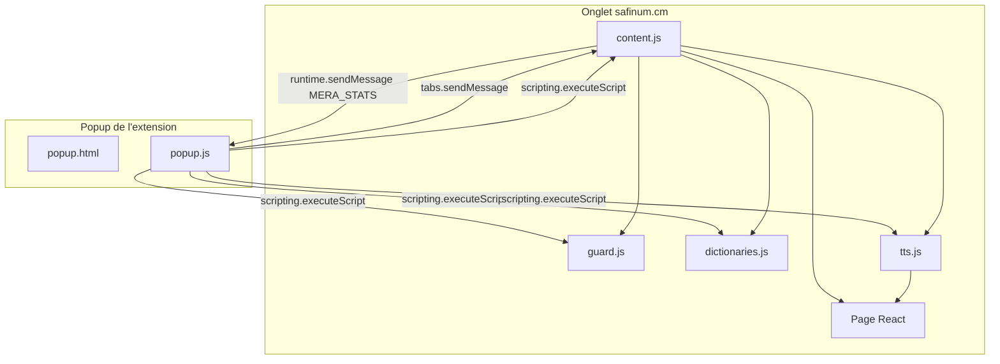
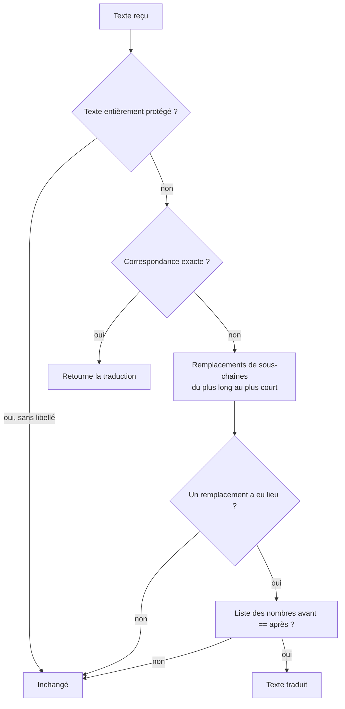
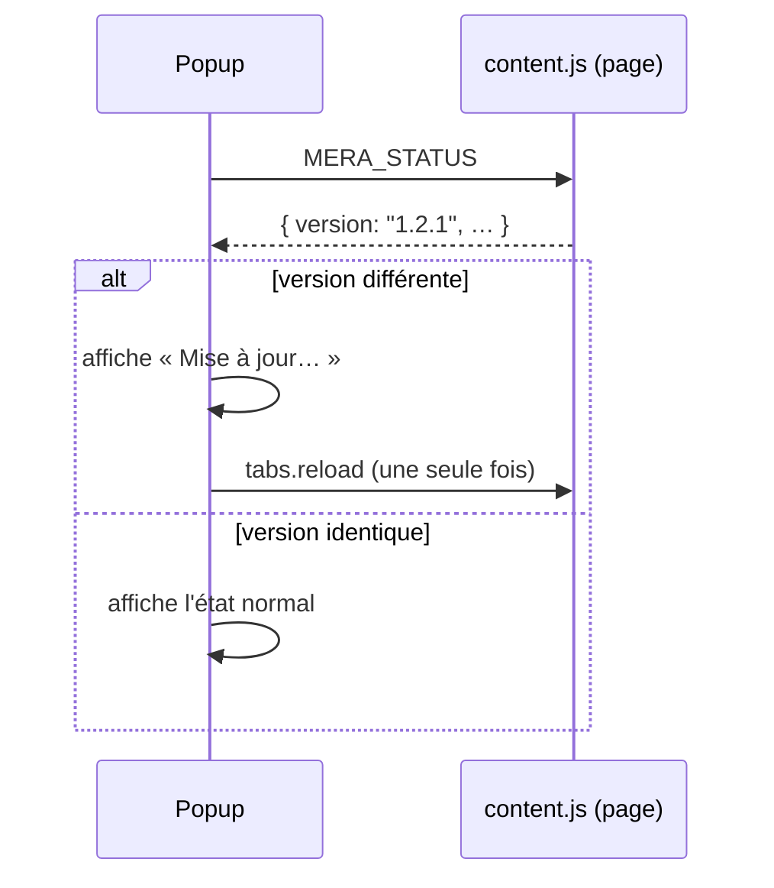

# Architecture

Ce document décrit le fonctionnement interne de MERA : modules, flux de
données, protocoles de messages et mécanismes de sécurité. Il s'adresse à un
développeur qui doit maintenir ou étendre l'extension.

---

## 1. Vue d'ensemble

MERA est une extension Chrome **Manifest V3** entièrement locale. Elle ne dépend
d'aucun serveur, d'aucune API et d'aucun modèle externe.



| Module | Rôle | Expose |
|---|---|---|
| `src/guard.js` | Décide ce qui est protégé ou ignoré | `window.__MERA_GUARD` |
| `src/dictionaries.js` | Six dictionnaires français → langue | `window.__MERA_DICTIONARIES` |
| `src/content.js` | Moteur de traduction, observateur, messages | `window.__MERA` |
| `src/tts.js` | Lecture vocale, indépendante du moteur | `window.__MERA_TTS` |
| `src/popup.js` | Contrôle, diagnostic, version | — |

L'ordre de chargement est imposé par le manifest :

```json
"js": ["src/guard.js", "src/dictionaries.js", "src/content.js", "src/tts.js"]
```

`guard.js` et `dictionaries.js` doivent précéder `content.js`, qui lit leurs
globals. `tts.js` est indépendant et peut être chargé après.

---

## 2. Le dictionnaire

`src/dictionaries.js` expose un objet par langue :

```js
window.__MERA_DICTIONARIES = {
  fr:  { label: "Français", map: { "Solde": "Solde", … } },
  en:  { label: "English",  map: { "Solde": "Balance", … } },
  ewo: { label: "Ewondo",   map: { "Solde": "Mòni", … } },
  ful: { label: "Fulfulde", map: { … } },
  bas: { label: "Basaa",    map: { … } },
  dua: { label: "Duala",    map: { … } },
};
```

### Règles d'écriture

- La clé est **exactement** un libellé français affiché par le site.
- Les 59 clés de `fr` servent de référence : toute langue doit couvrir ces clés.
- Une traduction identique au français est autorisée (`"Mobile Money"`), mais
  elle n'entre pas dans la table inverse.
- Les dates (`05 nov. 2026`) sont **absentes** : elles sont protégées par le
  garde-fou et ne doivent jamais être traduites.
- Chaque bloc de langue porte une note de relecture native
  (`// Relecture : locuteur natif …, 14 novembre 2026`).

Duala possède 62 clés (quelques variantes supplémentaires) ; les autres langues
en ont 59.

---

## 3. Le garde-fou (`guard.js`)

### `isProtected(text)`

Renvoie `true` — donc « ne pas traduire » — si le texte :

| Test | Expression | Couvre |
|---|---|---|
| 1 | `/[0-9]/` | montants, numéros, dates, références |
| 2 | `/\b(XAF\|FCFA\|F\s?CFA\|EUR\|USD)\b/i` | devises sans chiffre |
| 3 | `/[+()]/` | numéros de téléphone / compte |
| 4 | `/\b[A-Z]{2,}[-_][A-Z0-9]{2,}\b/` | références `SNF-2026-0001` |
| 5 | `/\b\d{1,2}[/.-]\d{1,2}[/.-]\d{2,4}\b/` | dates numériques |
| 6 | `t.includes("%")` | pourcentages |
| 7 | `/@\|https?:\/\//` | emails et URL |

### `isUserInput(node)` et `isIgnoredElement(el)`

- `isUserInput` remonte la chaîne des parents : tout nœud sous `INPUT`,
  `TEXTAREA`, `SELECT` ou `contenteditable` est ignoré.
- `isIgnoredElement` exclut aussi `SCRIPT`, `STYLE`, `NOSCRIPT`, `CODE`, `PRE`,
  `SVG`, `CANVAS`, `IFRAME`, `[data-mera-skip="1"]` et `[aria-hidden="true"]`.

Ces fonctions sont volontairement **sans état** : elles peuvent être appelées
sur n'importe quel nœud, à tout moment.

---

## 4. Moteur de traduction (`content.js`)

### 4.1 Structures d'état

```js
state = {
  language,        // code actif ("ewo", …)
  active,          // traduction en cours ?
  stats,           // { translated, protected, skipped }
  observer,        // MutationObserver
  originals,       // Map<nœud texte, texte source>
  attrOriginals,   // Map<élément, { attr: valeur }>
  timers,          // passes différées
}
```

Deux index sont construits à l'activation :

- `INDEX` — dictionnaire trié du plus long au plus court, plus une table
  insensible à la casse ;
- `INVERSE` / `INVERSE_SORTED` — table inverse « traduction → français »,
  construite sur **toutes** les langues.

### 4.2 Pourquoi une table inverse ?

Chrome ne remplace pas un content script déjà chargé quand l'extension est
rechargée. Une page peut donc afficher du texte dans une ancienne langue alors
que le moteur courant ne se souvient plus de l'avoir produit.

La table inverse permet de retrouver le français sans mémoire :

```
"Mɛ̀ ǹyega, Amina"  →  "Bonjour, Amina"  →  "Masug, Amina"
```

Deux mécanismes cohabitent :

- `toFrench(text)` — correspondance **exacte** (insensible à la casse) ;
- `toFrenchComposed(text)` — remplacement par **sous-chaînes**, indispensable
  pour les textes composés comme la salutation suivie d'un prénom.

`toFrenchComposed` ignore les entrées de moins de 3 caractères et traite les
plus longues d'abord, pour éviter les remplacements partiels.

### 4.3 Algorithme `translateText(text)`



Détails importants :

1. **Cas mixte.** Un texte comme `Numéro de compte : SNF-2026-0001` contient un
   chiffre, donc `isProtected` est vrai. Le moteur l'autorise malgré tout s'il
   contient un mot de 4 lettres et un `:` — pour traduire le libellé tout en
   conservant la valeur.
2. **Seuil de sous-chaîne.** Les clés de moins de 4 caractères ne participent
   pas aux remplacements de sous-chaînes, afin d'éviter les faux positifs
   (`Total`, `Nom`, etc. restent traités par correspondance exacte).
3. **Filet de sécurité numérique.** Après remplacement, `extractNumbers()`
   compare les nombres avant/après. Toute différence annule la traduction.

### 4.4 Parcours du DOM

`walk(root)` :

1. Vérifie `isIgnoredElement` sur les éléments.
2. Traduit les attributs `placeholder`, `title`, `aria-label`, `alt`.
3. Collecte les nœuds texte via `TreeWalker` (`SHOW_TEXT`).
4. Appelle `translateNode` sur chaque nœud non vide.

`translateNode` :

- ignore les zones de saisie et les éléments exclus ;
- si le nœud a déjà été traduit lors d'une passe précédente, incrémente le
  compteur sans retraduire ;
- sinon, retrouve le français (composé ou exact) puis traduit ;
- mémorise la source dans `state.originals`.

### 4.5 Cycle de vie

`activate(code)` :

1. `restore()` — remet la page en français et coupe l'observateur ;
2. construit les index ;
3. `translateAll()` — première passe ;
4. `startObserver()` — traduit les mutations futures ;
5. programme des passes différées à **200, 500, 1000, 2000 et 3500 ms** pour
   suivre le rendu progressif de React.

`restore()` :

- arrête les timers et l'observateur ;
- restaure les nœuds texte et les attributs depuis les maps ;
- supprime `[data-mera-translated]` ;
- remet les compteurs à zéro.

`startObserver()` regroupe les mutations avec `requestAnimationFrame` : une
seule passe par frame, pour ne pas figer la page.

---

## 5. Protocole de messages

Le popup et le content script communiquent par `chrome.tabs.sendMessage` /
`chrome.runtime.sendMessage`.

| Message | Émis par | Réponse | Effet |
|---|---|---|---|
| `MERA_STATUS` | popup | `{ active, language, stats, available, version }` | Lecture d'état |
| `MERA_ACTIVATE` | popup | `{ ok, version, stats }` | Change de langue et traduit |
| `MERA_DEACTIVATE` | popup | `{ ok, version }` | Restaure le français |
| `MERA_STATS` | content → popup | — | Met à jour les compteurs |
| `MERA_TTS` | popup | `{ supported, … }` | `speak-page`, `stop` |

### Gestion de `lastError`

Tout appel `runtime.sendMessage` / `tabs.sendMessage` lit explicitement
`chrome.runtime.lastError` dans son callback. Sans cela, Chrome journalise :

```
Unchecked runtime.lastError: Could not establish connection.
```

C'est le cas notamment quand le popup est fermé : personne ne reçoit
`MERA_STATS`. Le callback de `notify()` consomme donc l'erreur volontairement.

### Injection de secours

Si `MERA_ACTIVATE` échoue parce qu'aucun content script n'est présent (page
ouverte avant l'installation de l'extension), le popup appelle
`chrome.scripting.executeScript` pour injecter les quatre modules, puis réessaie.

Pour éviter une double instance, `content.js` commence par :

```js
if (window.__MERA) return;
```

Une seconde instance ne remplace donc jamais la première.

---

## 6. Négociation de version

Un content script chargé avant une mise à jour reste en mémoire. Le popup
compare la version annoncée par la page à `CONTENT_VERSION` (`1.3.0`) :



Le rechargement n'est déclenché qu'une fois par ouverture de popup
(`reloadedForVersion`) pour éviter une boucle.

---

## 7. Lecture vocale (`tts.js`)

`tts.js` est un module séparé, chargé après le moteur. Il :

- expose `window.__MERA_TTS` ;
- choisit la meilleure voix disponible : langue demandée, puis français, puis
  défaut ;
- lit uniquement le texte de la page déjà traduit ;
- filtre les montants et références avec le même garde-fou ;
- ne fait aucun appel réseau.

Limite : aucune voix locale n'existe pour les quatre langues camerounaises. La
voix française prononce les graphèmes latins (ɛ, ɔ, ŋ, ɓ, ɗ) de façon
indicative. Le module est isolé pour permettre le remplacement par un moteur
spécialisé sans toucher au moteur de traduction.

---

## 8. Interface du popup

`src/popup.html` + `src/popup.js` :

- menu de langue (6 options) ;
- boutons **Traduire la page** / **Restaurer** ;
- compteurs traduits / protégés / ignorés, rafraîchis toutes les 800 ms ;
- boutons **Écouter** / **Stop** ;
- démonstration statique de protection (`10 000 FCFA` → protégé) ;
- bouton **Diagnostic** : URL, présence du content script, versions, langue,
  nombre de textes traduits.

Le popup ne persiste pas la langue : à chaque ouverture, `refresh()` lit l'état
réel de la page sans écraser la sélection de l'utilisateur.

---

## 9. Points d'extension

| Besoin | Où intervenir |
|---|---|
| Ajouter une langue | `dictionaries.js` + option dans `popup.html` + `LANG_NAMES` / `SOLDE_PREVIEW` |
| Ajouter un libellé | Ajouter la clé française dans les 6 dictionnaires |
| Modifier le garde-fou | `guard.js` — attention aux tests `test-core` |
| Changer le moteur TTS | `tts.js` uniquement |
| Ajouter un message | `content.js` (`onMessage`) + `popup.js` |
| Étendre le périmètre | `manifest.json` (`matches`) + regex d'URL dans `popup.js` |

Toute modification du garde-fou ou du moteur doit être suivie de `npm test` :
les tests couvrent les valeurs financières et les six langues.
